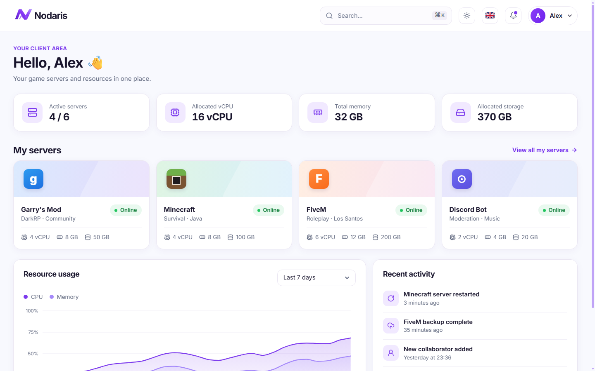
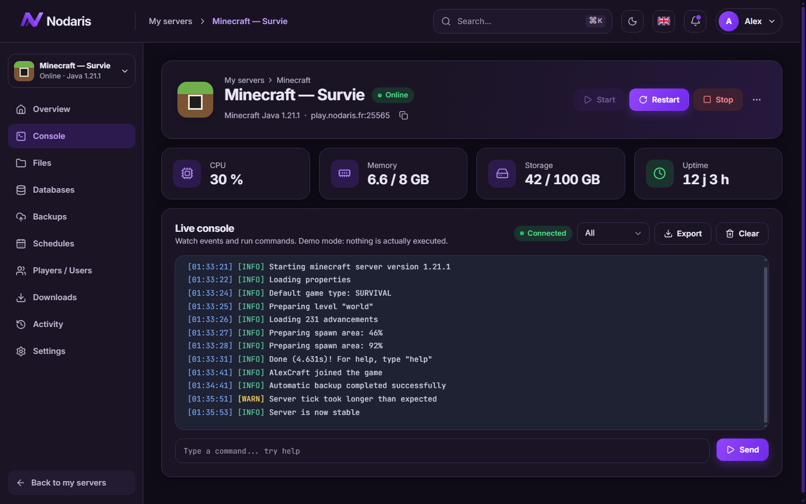
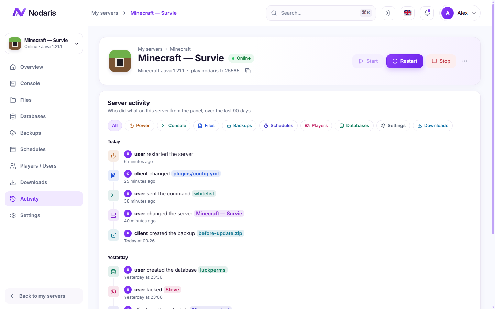
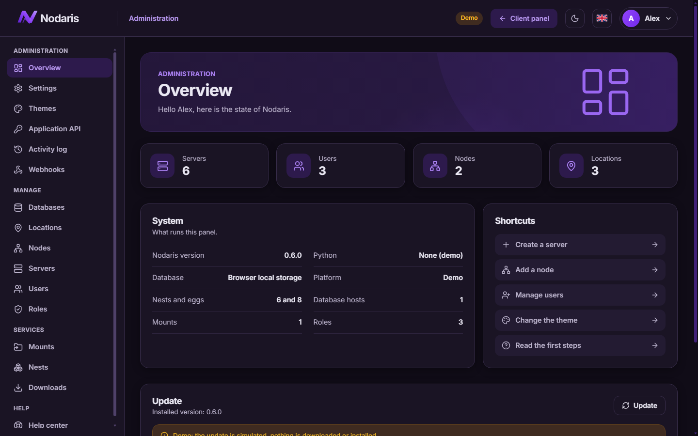
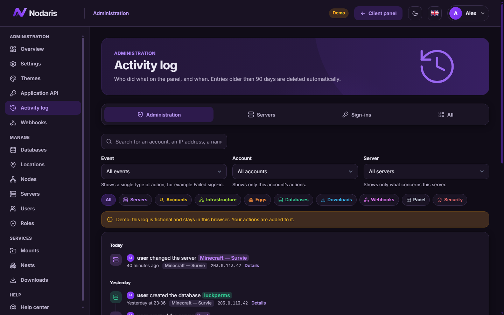
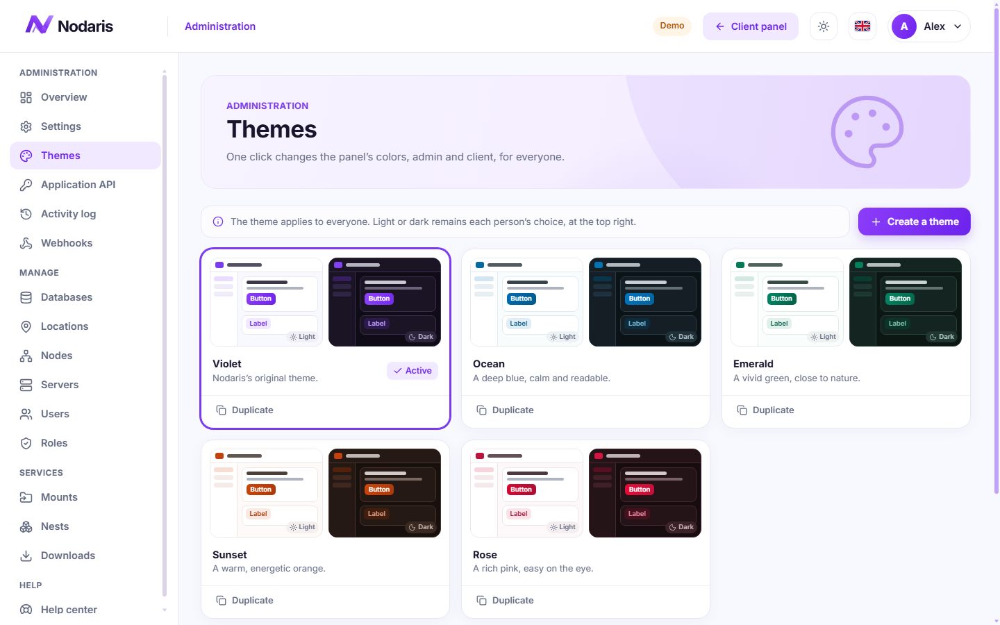
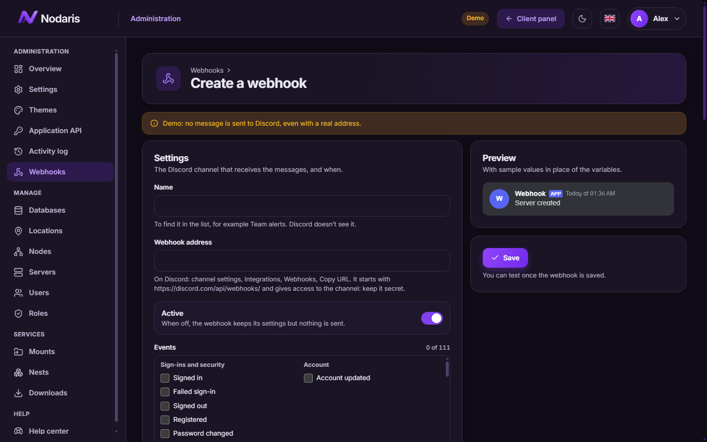

<div align="center">


# Nodaris

**A clean, modern game server panel for Linux.**
Install it with one command, manage everything from your browser.

[](https://github.com/HeX0TiiiKzz/nodaris-releases/releases/latest)
[](https://github.com/HeX0TiiiKzz/nodaris-releases/releases)
[](#-project-status)


**[🚀 Install](#-install)** &nbsp;·&nbsp;
**[🖥️ Add a node](#%EF%B8%8F-add-a-node)** &nbsp;·&nbsp;
**[✨ Features](#-features)** &nbsp;·&nbsp;
**[📸 Screenshots](#-screenshots)** &nbsp;·&nbsp;
**[🔄 Update](#-update)** &nbsp;·&nbsp;
**[🧰 Commands](#-commands)** &nbsp;·&nbsp;
**[🚧 Status](#-project-status)** &nbsp;·&nbsp;
**[📦 Releases](https://github.com/HeX0TiiiKzz/nodaris-releases/releases)**

</div>

<p align="center">
  <picture>
    <source media="(prefers-color-scheme: dark)" srcset=".github/assets/home-dark.png">
    
  </picture>
</p>

> [!WARNING]
> **Nodaris is an early preview.** It has been tested end to end on Ubuntu 24.04 under WSL2, not yet on a VPS exposed to the Internet. [See what works today](#-project-status), and use a machine you can wipe.

## 🚀 Install

On a fresh server, as root or with sudo:

```bash
curl -fsSL https://github.com/HeX0TiiiKzz/nodaris-releases/releases/latest/download/install.sh | sudo bash
```

The installer asks a few questions, then sets up the panel, its database, nginx and HTTPS. Sign in with the administrator account you create along the way.

| | Requirements |
|---|---|
| 🐧 **System** | Ubuntu 22.04, 24.04 or 26.04, or Debian 12 or 13, with systemd |
| 💻 **Hardware** | x86_64 or arm64 |
| 🌐 **Network** | Ports 80 and 443 free |
| 🔒 **HTTPS** | A domain pointing to the server, otherwise the panel runs over HTTP on the IP |

## 🖥️ Add a node

A node is the machine that runs your game servers. It can be the same machine as the panel.

1. In the panel, create a node in **Admin → Nodes**.
2. Open its **Configuration** tab and copy the install command.
3. Run it on the machine, and paste the token when the installer asks for it.

The installer sets up Docker and the Nodaris daemon. Your servers then start, stop and show their live console in the client area.

## ✨ Features

<table>
<tr>
<td width="50%" valign="top">

### 🎮 For your clients
- Start, stop and restart, with a live console
- Files, backups and SFTP
- Real databases, with import and export
- Activity page: who restarted, who edited what
- Quick downloads: plugins, mods, addons, texture packs, maps
- Two-factor authentication with recovery codes

</td>
<td width="50%" valign="top">

### 🛠️ For administrators
- Locations, nodes, allocations, servers, nests, eggs and mounts
- Node daemon in Go, with an installer of its own
- Roles with full, fine-grained permissions
- Community egg catalogue, installed in one click
- Activity log: who created, edited or deleted what
- Discord webhooks with a fully editable embed

</td>
</tr>
<tr>
<td width="50%" valign="top">

### 🎨 Make it yours
- Light and dark mode, following your system
- Built-in themes, or create your own
- Your name and logo, on the client and admin sides
- English, French, German and Russian

</td>
<td width="50%" valign="top">

### ⚙️ Easy to run
- One-command installer with a clear console
- One-click updates from the admin panel
- Automatic rollback if an update fails
- Built-in help centre for administrators

</td>
</tr>
</table>

## 📸 Screenshots

<table>
<tr>
<td width="50%"><p align="center"><b>Live console</b></p></td>
<td width="50%"><p align="center"><b>Who did what on a server</b></p></td>
</tr>
<tr>
<td width="50%"><p align="center"><b>Admin overview</b></p></td>
<td width="50%"><p align="center"><b>Activity log</b></p></td>
</tr>
<tr>
<td width="50%"><p align="center"><b>Themes, with light and dark previews</b></p></td>
<td width="50%"><p align="center"><b>Discord embed editor</b></p></td>
</tr>
</table>

## 🔄 Update

Open **Admin → Overview** and press **Update**: the panel checks for a new version, shows a progress bar, and asks you to refresh when it is done. If a step fails, it puts everything back as it was.

> [!NOTE]
> Coming from 0.5 or older? Run `nodaris update` once on the server. This installs the one-click updater, and you will not need SSH for updates after that.

## 🧰 Commands

| Command | What it does |
|---|---|
| `nodaris status` | Shows what is running |
| `nodaris logs` | Follows the panel logs |
| `nodaris update` | Installs the latest version |
| `nodaris repair` | Fixes the panel and keeps your data |
| `nodaris user:reset-password` | Resets a forgotten password |
| `nodaris user:disable-2fa` | Unlocks an account that lost its two-factor device |
| `nodaris uninstall` | Removes the panel |

## 🚧 Project status

| Part | State |
|---|---|
| Accounts, roles, 2FA, activity log, webhooks, themes | ✅ Working |
| Databases, import and export | ✅ Tested on MariaDB 10.11 |
| One-click updates and rollback | ✅ Tested on a real systemd |
| Node daemon: power, console, files, backups, SFTP | ✅ Tested with a real Paper server in Docker |
| A real player joining with the game | 🟡 Not tried yet |
| Schedules, collaborators, player list | 🟡 Still simulated, and they say so |
| Quick downloads | 🟡 Listed and logged, no file reaches a machine yet |
| A VPS on the Internet: UFW, Let's Encrypt, HTTPS | 🔴 Not validated yet |
| Debian, Ubuntu 22.04 and 26.04, ARM | 🔴 Not validated yet |

All of this was tested on Ubuntu 24.04 under WSL2, over HTTP.

<div align="center">

**[⬆ Back to top](#nodaris)** &nbsp;·&nbsp; **[📦 All releases](https://github.com/HeX0TiiiKzz/nodaris-releases/releases)** &nbsp;·&nbsp; **[🐛 Report a problem](https://github.com/HeX0TiiiKzz/nodaris-releases/issues/new)**

<sub>This repository only hosts the release files.</sub>

</div>
